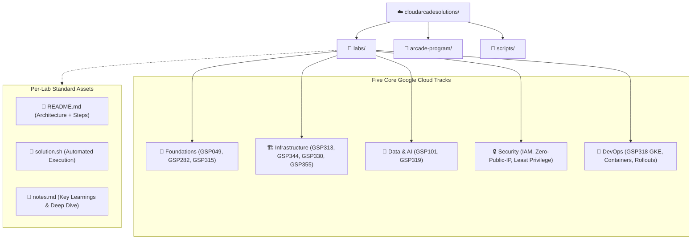

<div align="center">

# ☁️ Cloud Arcade Solutions

**Production-Grade Google Cloud Arcade & Skills Boost Solution Blueprints**

[](LICENSE)
[](https://cloudskillsboost.google)
[](#-completed-labs-by-track)
[](arcade-program/point-system-guide.md)
[](scripts/validate_labs.py)

> *Curated, reproducible, step-by-step solutions for Google Cloud Arcade skill badges, challenge labs, and monthly games.*

[📋 PRD](PRD.md) · [📝 TODO](TODO.md) · [📊 SUMMARY](SUMMARY.md) · [🎯 Swag Guide](arcade-program/point-system-guide.md) · [☁️ Skills Boost](https://cloudskillsboost.google)

</div>

---

## 🏗️ Architecture & Repository Topology



---

## 📚 Completed Labs by Track

### 1. 🌱 Foundations Track
| Lab ID | Lab Name | Key Technologies | Difficulty | Solution |
|---|---|---|---|---|
| **GSP049** | Cloud IAM: Qwik Start | IAM Policies, Service Accounts, Custom Roles | ⭐ Introductory | [README](labs/gsp049-cloud-iam-qwik-start/README.md) · [Script](labs/gsp049-cloud-iam-qwik-start/solution.sh) · [Notes](labs/gsp049-cloud-iam-qwik-start/notes.md) |
| **GSP282** | A Tour of Firebase | Firebase Hosting, Cloud Firestore Native | ⭐ Introductory | [README](labs/gsp282-a-tour-of-firebase/README.md) · [Script](labs/gsp282-a-tour-of-firebase/solution.sh) · [Notes](labs/gsp282-a-tour-of-firebase/notes.md) |
| **GSP315** | Perform Foundational Infrastructure Tasks | Cloud Storage, Pub/Sub, Cloud Functions Gen 2 | ⭐⭐ Intermediate | [README](labs/gsp315-perform-foundational-infrastructure-tasks/README.md) · [Script](labs/gsp315-perform-foundational-infrastructure-tasks/solution.sh) · [Notes](labs/gsp315-perform-foundational-infrastructure-tasks/notes.md) |

### 2. 🏗️ Infrastructure Track
| Lab ID | Lab Name | Key Technologies | Difficulty | Solution |
|---|---|---|---|---|
| **GSP313** | Set Up a Google Cloud Network | Custom VPC, Multi-region Subnets, Bastion Host | ⭐⭐ Intermediate | [README](labs/gsp313-set-up-a-google-cloud-network/README.md) · [Script](labs/gsp313-set-up-a-google-cloud-network/solution.sh) · [Notes](labs/gsp313-set-up-a-google-cloud-network/notes.md) |
| **GSP344** | Networking in Google Cloud | Cloud NAT, VPC Peering, Private Google Access | ⭐⭐ Intermediate | [README](labs/gsp344-networking-in-google-cloud/README.md) · [Script](labs/gsp344-networking-in-google-cloud/solution.sh) · [Notes](labs/gsp344-networking-in-google-cloud/notes.md) |
| **GSP330** | Implement Load Balancing on Compute Engine | Managed Instance Groups, Health Checks, Global HTTP LB | ⭐⭐ Intermediate | [README](labs/gsp330-implement-load-balancing-on-compute-engine/README.md) · [Script](labs/gsp330-implement-load-balancing-on-compute-engine/solution.sh) · [Notes](labs/gsp330-implement-load-balancing-on-compute-engine/notes.md) |
| **GSP355** | CloudSQL PostgreSQL Challenge Lab | Database Migration Service, PostgreSQL CDC, IAM Auth, PITR | ⭐⭐ Intermediate | [README](labs/gsp355-cloudsql-postgresql-challenge-lab/README.md) · [Script](labs/gsp355-cloudsql-postgresql-challenge-lab/solution.sh) · [Notes](labs/gsp355-cloudsql-postgresql-challenge-lab/notes.md) |

### 3. 🤖 Data & AI Track
| Lab ID | Lab Name | Key Technologies | Difficulty | Solution |
|---|---|---|---|---|
| **GSP101** | Google Cloud Speech-to-Text API | Speech REST API, Neural Acoustic Models | ⭐ Introductory | [README](labs/gsp101-google-cloud-speech-api/README.md) · [Script](labs/gsp101-google-cloud-speech-api/solution.sh) · [Notes](labs/gsp101-google-cloud-speech-api/notes.md) |
| **GSP319** | Build & Deploy ML on Vertex AI | Scikit-learn, Model Registry, Online Endpoints | ⭐⭐⭐ Advanced | [README](labs/gsp319-build-and-deploy-machine-learning-solutions-on-vertex-ai/README.md) · [Script](labs/gsp319-build-and-deploy-machine-learning-solutions-on-vertex-ai/solution.sh) · [Notes](labs/gsp319-build-and-deploy-machine-learning-solutions-on-vertex-ai/notes.md) |

### 4. 🔒 Security & Governance
| Lab ID | Lab Name | Security Focus | Difficulty | Solution |
|---|---|---|---|---|
| **GSP049** | Cloud IAM Governance | Least Privilege, Audit Logging, IAM Revocation | ⭐ Introductory | [README](labs/gsp049-cloud-iam-qwik-start/README.md) · [Notes](labs/gsp049-cloud-iam-qwik-start/notes.md) |
| **GSP355** | Cloud SQL Database Security | IAM Database Authentication, Cloud SQL Users | ⭐⭐ Intermediate | [README](labs/gsp355-cloudsql-postgresql-challenge-lab/README.md) · [Notes](labs/gsp355-cloudsql-postgresql-challenge-lab/notes.md) |

### 5. 🚀 DevOps Track
| Lab ID | Lab Name | Key Technologies | Difficulty | Solution |
|---|---|---|---|---|
| **GSP318** | Deploy to Kubernetes in Google Cloud | GKE, Docker, Artifact Registry, Rolling Updates | ⭐⭐ Intermediate | [README](labs/gsp318-deploy-to-kubernetes-in-google-cloud/README.md) · [Script](labs/gsp318-deploy-to-kubernetes-in-google-cloud/solution.sh) · [Notes](labs/gsp318-deploy-to-kubernetes-in-google-cloud/notes.md) |

---

## 🎯 Arcade Program & Swag Resources

- [🎯 Point System & Swag Strategy Guide](arcade-program/point-system-guide.md): Point breakdowns, milestone bonuses, prize counter tiers, and swag optimization.
- [⚡ Monthly Game Fast-Track Strategies](arcade-program/monthly-game-strategies.md): Speedrun blueprints, quota management, and time-saving Cloud Shell workflows.
- [🧠 Master Arcade Trivia Bank](arcade-program/trivia-bank.md): Curated question & verified answer repository across all GCP technical categories.

---

## 🚀 Quickstart: Running Solutions in Google Cloud Shell

```bash
# 1. Clone the repository in Google Cloud Shell
git clone https://github.com/harinish45/cloudarcadesolutions.git
cd cloudarcadesolutions

# 2. Navigate to your desired lab (example: GSP318 GKE Challenge)
cd labs/gsp318-deploy-to-kubernetes-in-google-cloud

# 3. Read the solution architecture & execute automated script
cat README.md
bash solution.sh
```

---

## 🧪 Repository Verification & Quality Gates

Run the built-in automated validator across all markdown documents, shell scripts, and Mermaid diagrams:

```bash
# Run python validator
python3 scripts/validate_labs.py --path .

# Run test suite
pytest -v tests/
```

---

## 📄 License
This project is open source and available under the [MIT License](LICENSE).
