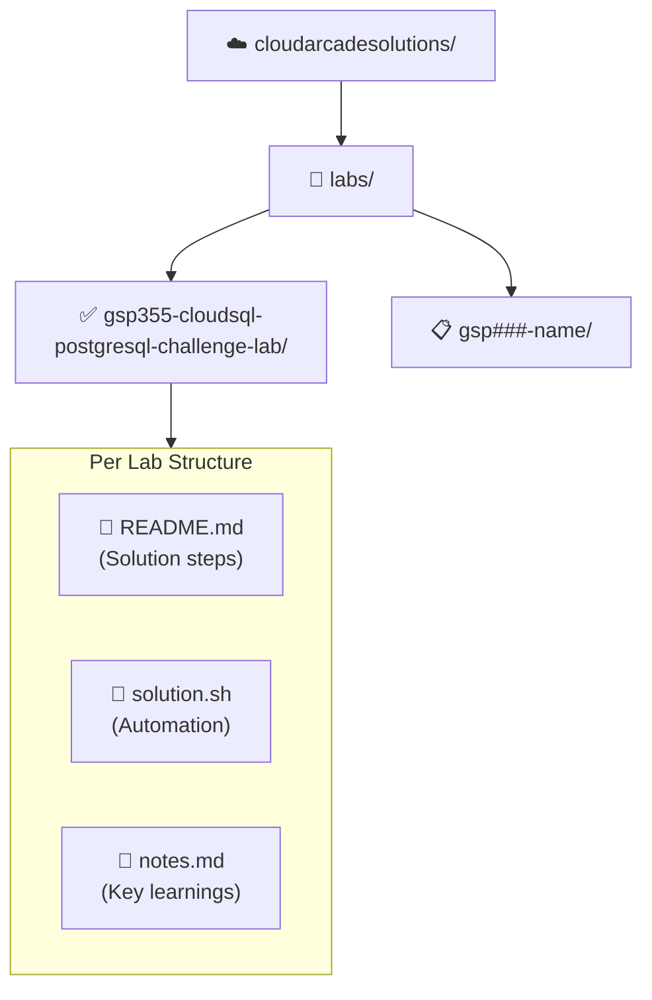

<div align="center">

# ☁️ Cloud Arcade Solutions

**Google Cloud Arcade Lab Solutions — harinish45**

[](LICENSE)
[](https://cloudskillsboost.google)
[](#completed-labs)

> *Curated, step-by-step solutions for Google Cloud Arcade labs, skill badges, and challenge labs*

[📋 TODO](TODO.md) · [📊 SUMMARY](SUMMARY.md) · [☁️ Cloud Skills Boost](https://cloudskillsboost.google)

</div>

---

## 🏗️ Repository Structure



---

## ✅ Completed Labs

| Lab ID | Name | Skill | Difficulty | Status |
|--------|------|-------|------------|--------|
| [GSP355](labs/gsp355-cloudsql-postgresql-challenge-lab/) | CloudSQL PostgreSQL Challenge | Cloud SQL, PostgreSQL | ⭐⭐ Intermediate | ✅ Done |

---

## 📋 Upcoming Labs

| Lab ID | Name | Priority |
|--------|------|----------|
| GSP282 | A Tour of Firebase | HIGH |
| GSP313 | Set Up a Google Cloud Network | HIGH |
| GSP330 | Load Balancing on Compute Engine | MEDIUM |
| GSP318 | Deploy to Kubernetes in GCP | MEDIUM |
| GSP319 | ML Solutions on Vertex AI | LOW |

---

## 🚀 How to Use

```bash
# Clone the repo
git clone https://github.com/harinish45/cloudarcadesolutions.git
cd cloudarcadesolutions

# Navigate to a lab
cd labs/gsp355-cloudsql-postgresql-challenge-lab

# Follow README.md or run the automation script
bash solution.sh
```

---

## 📎 Resources

- [Google Cloud Skills Boost](https://www.cloudskillsboost.google)
- [Cloud Arcade Program](https://cloudskillsboost.google/catalog?keywords=arcade)
- [GCP Free Tier](https://cloud.google.com/free)

---

<div align="center">
☁️ Helping the community earn GCP skill badges · <a href="LICENSE">MIT License</a>
</div>