# 📊 Implementation Summary & Report — Cloud Arcade Solutions

> **Repository**: [cloudarcadesolutions](https://github.com/harinish45/cloudarcadesolutions.git)
> **Branch**: `main`
> **Status**: Completed & Verified
> **Date**: October 31, 2026

---

## 🎯 Executive Overview
The **Cloud Arcade Solutions** repository has been transformed from an early single-lab stub into an enterprise-grade Google Cloud Arcade & Skills Boost reference collection.

All 10 planned core lab solutions across 5 technical tracks, along with comprehensive Arcade program strategy guides, automated validation tooling, unit tests, and architecture diagrams have been fully authored and verified.

---

## 🏛️ Completed Solutions Catalog

```mermaid
flowchart TD
    Catalog["☁️ Cloud Arcade Solutions"]
    
    Catalog --> Foundations["Foundations Track"]
    Foundations --> GSP049["GSP049: Cloud IAM: Qwik Start"]
    Foundations --> GSP282["GSP282: A Tour of Firebase"]
    Foundations --> GSP315["GSP315: Foundational Infrastructure Tasks"]

    Catalog --> Infra["Infrastructure Track"]
    Infra --> GSP313["GSP313: Set Up a Google Cloud Network"]
    Infra --> GSP344["GSP344: Networking in Google Cloud"]
    Infra --> GSP330["GSP330: Implement Load Balancing on GCE"]
    Infra --> GSP355["GSP355: CloudSQL PostgreSQL Challenge"]

    Catalog --> DataAI["Data & AI Track"]
    DataAI --> GSP101["GSP101: Cloud Speech-to-Text API"]
    DataAI --> GSP319["GSP319: ML Solutions on Vertex AI"]

    Catalog --> DevOps["DevOps & Security Track"]
    DevOps --> GSP318["GSP318: Deploy to Kubernetes on GKE"]

    Catalog --> ArcadeProg["Arcade Program Guides"]
    ArcadeProg --> Points["Point System & Swag Strategy"]
    ArcadeProg --> Monthly["Monthly Game Optimization"]
    ArcadeProg --> Trivia["Categorized Trivia Answer Bank"]
```

---

## 📁 Artifact Inventory

### 1. Lab Solutions (10 Labs)
Every lab contains the standardized three-file format (`README.md`, `solution.sh`, `notes.md`):
- `labs/gsp049-cloud-iam-qwik-start/`: IAM policies, custom roles, service account binding, least privilege.
- `labs/gsp101-google-cloud-speech-api/`: Cloud Speech-to-Text REST API, audio encoding formats, neural transcription.
- `labs/gsp282-a-tour-of-firebase/`: Firebase Hosting, Firestore Native Mode, security rules, global CDN distribution.
- `labs/gsp313-set-up-a-google-cloud-network/`: Multi-region custom VPC, regional subnets, tagged firewall rules, bastion host.
- `labs/gsp315-perform-foundational-infrastructure-tasks/`: Cloud Storage buckets, Pub/Sub topics, Cloud Functions Gen 2, IAM cleanup.
- `labs/gsp318-deploy-to-kubernetes-in-google-cloud/`: GKE cluster creation, Artifact Registry, Kubernetes Deployment, LoadBalancer Service, rolling update.
- `labs/gsp319-build-and-deploy-machine-learning-solutions-on-vertex-ai/`: Scikit-Learn training, Vertex AI Model Registry, prediction endpoints, real-time inference.
- `labs/gsp330-implement-load-balancing-on-compute-engine/`: Instance templates, Managed Instance Groups, Health checks, URL maps, Global Anycast HTTP LB.
- `labs/gsp344-networking-in-google-cloud/`: Cloud Router, Cloud NAT, bidirectional VPC Network Peering, Private Google Access.
- `labs/gsp355-cloudsql-postgresql-challenge-lab/`: Database Migration Service (DMS), PostgreSQL CDC replication, IAM Database authentication, PITR clone.

### 2. Arcade Program Strategy
- `arcade-program/point-system-guide.md`: Point values, skill badge milestones, swag tiers (Standard, Mid, Advanced, Legend).
- `arcade-program/monthly-game-strategies.md`: Speedrun blueprints, Cloud Shell tips, quota and credit management.
- `arcade-program/trivia-bank.md`: Categorized question bank across Compute, Storage, Networking, Security, and Big Data / AI.

### 3. Tooling & Validation
- `scripts/validate_labs.py`: Python CLI tool validating markdown syntax, closed code fences, Mermaid diagram validity, and internal relative links.
- `scripts/run_all_validations.sh`: Bash CI/CD script running Python validator and `bash -n` syntax check on all shell scripts.
- `tests/test_lab_validator.py`: Comprehensive test suite for the validator logic.
- `.env.example`: Environment configuration template for active lab sessions.
- `PRD.md`: Formal Product Requirements Document.
- `TODO.md`: Master roadmap and completed milestone tracker.
- `README.md`: Master repository table of contents categorized by track with badges.

---

## 🔍 Validation Results
- **Broken Links**: 0 (all internal relative markdown links resolve correctly).
- **Code Fences**: 100% closed and valid.
- **Mermaid Diagrams**: All 11 diagrams use valid diagram types (`flowchart LR`, `flowchart TD`, `graph TD`, `graph TB`).
- **Shell Scripts**: All scripts declare bash shebang and safety flags (`set -Eeuo pipefail` / `trap`), clean syntax verified.
