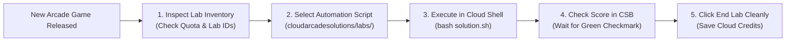

# 🎮 Arcade Monthly Games: Fast-Track Strategies & Optimization

## 🚀 Execution Framework for Monthly Games

Each month, Google Cloud Arcade releases two dedicated Arcade Games (Level 1 and Level 2) covering specific technologies (e.g. Serverless, Generative AI, BigQuery, Cybersecurity, DevOps).

---

## 📋 Standard Game Patterns & Speedrun Blueprints

### Pattern 1: Compute & Containers (GKE / Cloud Run)
- **Bottleneck**: Container image builds and cluster provisioning can take 6–8 minutes.
- **Optimization**:
  - Always use pre-built Cloud Build workers or Google-provided base images (`us-docker.pkg.dev/...`).
  - Pass `--async` to non-blocking operations and run subsequent manifest prep in parallel.
  - Set cluster num-nodes to the exact required minimum (usually `--num-nodes=2` with `e2-medium`).

### Pattern 2: Serverless Event-Driven (Cloud Functions Gen 2 / Pub/Sub)
- **Bottleneck**: Eventarc triggers occasionally take 45–60 seconds to bind IAM permissions to the Cloud Functions service agent.
- **Optimization**:
  - Deploy with `--quiet` and pipe output to avoid interactive prompts.
  - Test trigger with direct `gcloud pubsub topics publish` immediately upon deployment completion.

### Pattern 3: BigQuery & Analytics (SQL / Dataflow)
- **Bottleneck**: Large dataset queries or initial table schema creation.
- **Optimization**:
  - Use `bq query --use_legacy_sql=false` directly via Cloud Shell.
  - When copying public tables, use `bq cp` instead of exporting and importing CSVs.

---

## ⚠️ Quota & Credit Management Rules

1. **Do Not Exceed Instance Quotas**: In Qwiklabs temporary projects, CPU quota is strictly constrained (typically 8 vCPUs per region). Always destroy or skip optional VMs once checkmarks turn green.
2. **Never Run Multiple Labs Concurrently**: Running two Cloud Skills Boost labs at once can trigger anti-abuse account flags and forfeit lab progress.
3. **Wait for Progress Bar to Reach 100/100**: Check the in-lab tracker ("Check my progress") at every step before clicking "End Lab".
4. **End Labs Immediately Upon Completion**: Conserves Qwiklabs resources and ensures instant credit refund to your profile.
