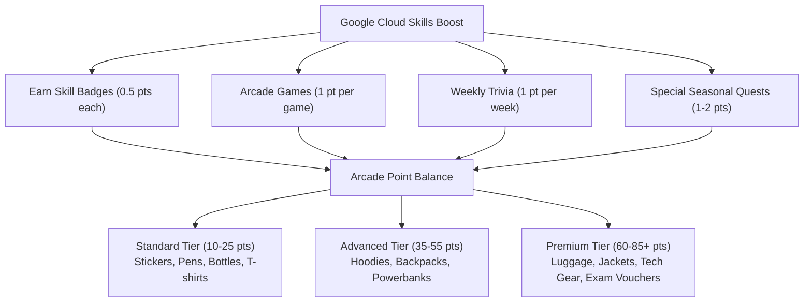

# 🎯 Google Cloud Arcade: Master Point System & Swag Strategy Guide

## 📊 Overview of the Arcade Point Economy

The Google Cloud Arcade program rewards learners with Arcade Points that can be exchanged for official Google Cloud swag and certification vouchers during the bi-annual Prize Counter openings (typically July and December).

---

## 🧮 Point Values Breakdown

| Activity | Point Value | Frequency | Max Points / Month |
|---|---|---|---|
| **Skill Badges** | 0.5 Point per Badge (via Milestone Bonus) | Unlimited | 5–10 Points |
| **Arcade Monthly Games** | 1 Point per Game | 2 Games per Month | 2 Points |
| **Arcade Trivia** | 1 Point per Trivia Week | 4 Weeks per Month | 4 Points |
| **Certification Challenge** | Up to 10 Points | Seasonal | Varies |
| **Arcade Insider Email Quests** | 1 Point | Monthly | 1 Point |

### Skill Badge Milestone Calculations
Google Cloud Arcade awards points for completing Skill Badges through structured milestones:
- **Milestone 1**: Complete 3 Skill Badges = 1 Arcade Point
- **Milestone 2**: Complete 6 Skill Badges = 2 Arcade Points
- **Milestone 3**: Complete 9 Skill Badges = 3 Arcade Points
- **Milestone 4**: Complete 12 Skill Badges = 4 Arcade Points
- **Milestone 5**: Complete 15+ Skill Badges = 5 Arcade Points

---

## 🏆 Prize Counter Swag Tiers & Milestones

| Tier | Required Points | Example Swag Items | Recommended Target |
|---|---|---|---|
| **Tier 1 (Base)** | 10 – 20 Points | Google Cloud Arcade Sticker Packs, Stainless Water Bottles, Notebooks | Casual Learners |
| **Tier 2 (Mid)** | 25 – 45 Points | Cloud Developer T-Shirt, Premium Ceramic Mug, Desk Mat, Tech Pouch | Active Participants |
| **Tier 3 (Advanced)**| 50 – 70 Points | Google Cloud Embroidered Hoodie, Anker 20,000mAh Power Bank, Backpack | Dedicated Badgers |
| **Tier 4 (Legend)** | 75 – 90+ Points | Executive Hard-Shell Carry-On, Premium Bomber Jacket, Google Cloud Exam Voucher | Completionists |

---

## ⚡ Pro Tips for Maximizing Points

1. **Prioritize Challenge Labs First**: Skill badges always conclude with a Challenge Lab. Use the reproducible scripts in `cloudarcadesolutions` to complete labs in under 5 minutes without wasted quota.
2. **Never Miss Monday Trivia**: Trivia games open every Monday and expire Sunday at 11:59 PM PT. Set automated calendar reminders.
3. **Keep Cloud Shell Open**: Run automated verification scripts directly in Cloud Shell; avoid local gcloud CLI token churn.
4. **Track Multiple Accounts**: Ensure your Google Cloud Skills Boost public profile URL is connected to the exact email address registered with the Arcade Insider newsletter.
