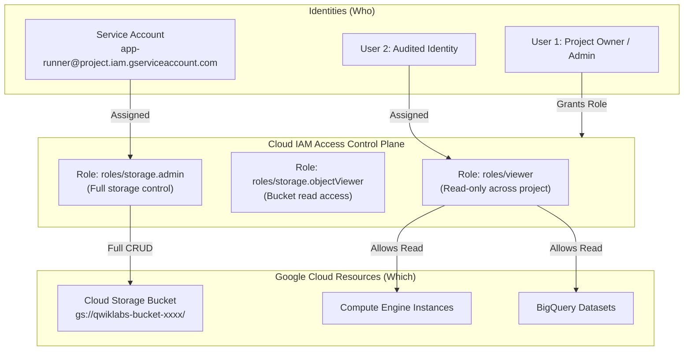

# GSP049: Cloud IAM: Qwik Start


## 📋 Overview
Google Cloud Identity and Access Management (IAM) provides fine-grained access control over Google Cloud resources.

In this lab, you:
1. Examine existing IAM policy bindings on a Google Cloud project.
2. Grant predefined and primitive IAM roles to specific user identities and service accounts.
3. Validate permissions by attempting permitted and restricted operations.
4. Update and revoke access policies and review Cloud Audit Logs.

---

## 🏛️ Architecture Topology



---

## ⚙️ Environment Variables

| Variable | Description | Example |
|---|---|---|
| `PROJECT_ID` | GCP Project ID | `qwiklabs-gcp-02-xxxx` |
| `USER2_EMAIL` | Secondary lab user email | `student-02-xxxx@qwiklabs.net` |
| `BUCKET_NAME` | Cloud Storage bucket | `gsp049-test-bucket-xxxx` |
| `SERVICE_ACCOUNT` | Test service account | `iam-demo-sa` |

---

## 🚀 Step-by-Step Implementation

### Step 1: Inspect Current Project IAM Policy
View all existing role bindings on the project:
```bash
gcloud projects get-iam-policy "$DEVSHELL_PROJECT_ID" \
  --format="table(bindings.role, bindings.members)"
```

### Step 2: Create a Cloud Storage Test Bucket
Create a private bucket to test storage authorization boundaries:
```bash
BUCKET_NAME="${DEVSHELL_PROJECT_ID}-iam-test"
gcloud storage buckets create "gs://${BUCKET_NAME}" --location=us-central1
echo "Confidential test payload" > sample.txt
gcloud storage cp sample.txt "gs://${BUCKET_NAME}/"
```

### Step 3: Grant Predefined Role to Secondary Identity
Assign `roles/viewer` to allow read-only access:
```bash
gcloud projects add-iam-policy-binding "$DEVSHELL_PROJECT_ID" \
  --member="user:${USER2_EMAIL:-student-02-demo@qwiklabs.net}" \
  --role="roles/viewer" \
  --condition=None
```

Assign granular `roles/storage.objectViewer` on the bucket:
```bash
gcloud storage buckets add-iam-policy-binding "gs://${BUCKET_NAME}" \
  --member="user:${USER2_EMAIL:-student-02-demo@qwiklabs.net}" \
  --role="roles/storage.objectViewer"
```

### Step 4: Create a Dedicated Service Account
```bash
# Create service account
gcloud iam service-accounts create iam-demo-sa \
  --display-name="GSP049 Automation Service Account"

SA_EMAIL="iam-demo-sa@${DEVSHELL_PROJECT_ID}.iam.gserviceaccount.com"

# Bind Storage Object Admin role to service account
gcloud projects add-iam-policy-binding "$DEVSHELL_PROJECT_ID" \
  --member="serviceAccount:${SA_EMAIL}" \
  --role="roles/storage.objectAdmin"
```

### Step 5: Revoke Role Binding
Remove primitive role when no longer required:
```bash
gcloud projects remove-iam-policy-binding "$DEVSHELL_PROJECT_ID" \
  --member="user:${USER2_EMAIL:-student-02-demo@qwiklabs.net}" \
  --role="roles/viewer"
```

---

## 🔍 Verification & Audit

Verify policy binding was properly committed:
```bash
gcloud projects get-iam-policy "$DEVSHELL_PROJECT_ID" \
  --flatten="bindings[].members" \
  --filter="bindings.members:iam-demo-sa" \
  --format="table(bindings.role)"
```

Expected output:
```text
ROLE
roles/storage.objectAdmin
```
