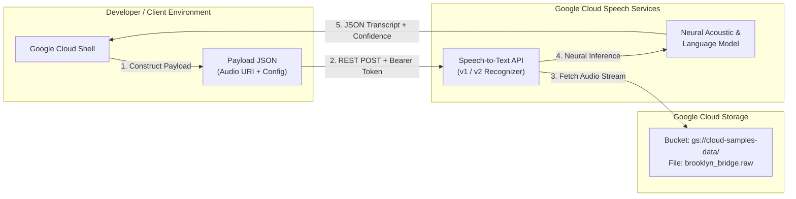

# GSP101: Google Cloud Speech-to-Text API


## 📋 Overview
Google Cloud Speech-to-Text enables developers to convert audio into text in over 125 languages and variants by applying powerful neural network models.

In this lab, you:
1. Enable the Cloud Speech-to-Text API.
2. Generate secure authentication credentials via API Key and Service Account bearer tokens.
3. Construct synchronous speech recognition JSON payloads targeting raw audio formats (FLAC, LINEAR16).
4. Transcribe audio files stored in Google Cloud Storage (`gs://`).
5. Process and inspect transcription outputs, alternative hypotheses, and word-level confidence scores.

---

## 🏛️ Architecture Topology



---

## ⚙️ Environment Variables

| Variable | Description | Example |
|---|---|---|
| `PROJECT_ID` | Active GCP Project | `qwiklabs-gcp-00-xxxx` |
| `AUDIO_URI` | Cloud Storage audio path | `gs://cloud-samples-data/speech/brooklyn_bridge.raw` |
| `ENCODING` | Audio encoding format | `LINEAR16` |
| `SAMPLE_RATE` | Sample rate in Hertz | `16000` |
| `LANG_CODE` | BCP-47 language tag | `en-US` |

---

## 🚀 Step-by-Step Implementation

### Step 1: Enable the Cloud Speech API
```bash
gcloud services enable speech.googleapis.com
```

### Step 2: Create API Key / Obtain Bearer Token
Obtain an OAuth2 access token directly in Cloud Shell:
```bash
ACCESS_TOKEN="$(gcloud auth print-access-token)"
```

### Step 3: Construct the Speech Recognition Request
Create `request.json` specifying audio parameters and Google Cloud Storage URI:
```bash
cat <<'JSON' > request.json
{
  "config": {
    "encoding": "LINEAR16",
    "sampleRateHertz": 16000,
    "languageCode": "en-US",
    "enableWordTimeOffsets": false
  },
  "audio": {
    "uri": "gs://cloud-samples-data/speech/brooklyn_bridge.raw"
  }
}
JSON
```

### Step 4: Execute Synchronous Recognition Request
Invoke the v1 REST API endpoint:
```bash
curl -s -X POST \
  -H "Authorization: Bearer $(gcloud auth print-access-token)" \
  -H "Content-Type: application/json; charset=utf-8" \
  --data @request.json \
  https://speech.googleapis.com/v1/speech:recognize > response.json
```

---

## 🔍 Verification & Inspect Output

View formatted JSON transcript response:
```bash
cat response.json
```

Expected output:
```json
{
  "results": [
    {
      "alternatives": [
        {
          "transcript": "how old is the Brooklyn Bridge",
          "confidence": 0.98267895
        }
      ]
    }
  ]
}
```

Verify transcription field with `jq`:
```bash
jq -r '.results[0].alternatives[0].transcript' response.json
```
Output:
```text
how old is the Brooklyn Bridge
```
