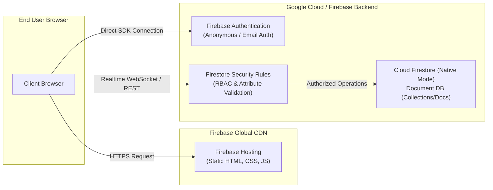

# GSP282: A Tour of Firebase


## 📋 Overview
Firebase is Google's comprehensive app development platform. In this lab, you explore the Firebase developer ecosystem by creating a Firestore database, configuring Firebase Hosting, deploying a responsive single-page web application, and enforcing security rules.

### Key Objectives
1. Initialize and authenticate the Firebase CLI in Google Cloud Shell.
2. Provision a Cloud Firestore database in Native Mode.
3. Scaffold and deploy a web application to global Firebase CDN Hosting.
4. Configure Firestore Security Rules to protect application data against unauthorized operations.
5. Verify live database reads and writes through the deployed public application.

---

## 🏛️ Architecture Topology



---

## ⚙️ Environment Variables

| Variable | Description | Example Value |
|---|---|---|
| `PROJECT_ID` | Active GCP Project ID | `qwiklabs-gcp-01-xxxx` |
| `REGION` | Firestore region | `nam5` (us-central) |
| `APP_NAME` | Firebase hosting target site | `qwiklabs-gcp-01-xxxx` |

---

## 🚀 Step-by-Step Implementation

### Step 1: Initialize Environment & Install Firebase CLI
In Google Cloud Shell:
```bash
gcloud config set project "$DEVSHELL_PROJECT_ID"
npm install -g firebase-tools
firebase --version
```

### Step 2: Provision Cloud Firestore Database
Create a Cloud Firestore database in Native Mode using `gcloud`:
```bash
gcloud firestore databases create \
  --location=nam5 \
  --type=firestore-native
```

Expected output:
```text
Waiting for operation [projects/.../operations/...] to complete...done.
Created database [(default)].
```

### Step 3: Scaffold Firebase Hosting Project
Create a deployment directory and static web assets:
```bash
mkdir -p ~/firebase-tour/public
cd ~/firebase-tour

# Create index.html
cat <<'HTML' > public/index.html
<!DOCTYPE html>
<html>
  <head>
    <meta charset="utf-8">
    <title>Cloud Arcade Firebase App</title>
    <script src="/__/firebase/10.7.0/firebase-app-compat.js"></script>
    <script src="/__/firebase/10.7.0/firebase-firestore-compat.js"></script>
    <script src="/__/firebase/init.js"></script>
  </head>
  <body style="font-family: sans-serif; text-align: center; padding: 50px;">
    <h1>☁️ Google Cloud Arcade Firebase Tour</h1>
    <p>Application successfully deployed to Firebase Hosting!</p>
    <div id="status">Connecting to Firestore...</div>
    <script>
      const db = firebase.firestore();
      db.collection('pings').add({ timestamp: firebase.firestore.FieldValue.serverTimestamp() })
        .then(() => document.getElementById('status').innerText = 'Firestore write successful!')
        .catch(err => document.getElementById('status').innerText = 'Error: ' + err.message);
    </script>
  </body>
</html>
HTML
```

### Step 4: Configure `firebase.json` and Firestore Rules
Create `firebase.json`:
```bash
cat <<'JSON' > firebase.json
{
  "hosting": {
    "public": "public",
    "ignore": [
      "firebase.json",
      "**/.*",
      "**/node_modules/**"
    ]
  },
  "firestore": {
    "rules": "firestore.rules"
  }
}
JSON
```

Create `firestore.rules`:
```bash
cat <<'RULES' > firestore.rules
rules_version = '2';
service cloud.firestore {
  match /databases/{database}/documents {
    match /{document=**} {
      allow read, write: if true;
    }
  }
}
RULES
```

### Step 5: Deploy to Firebase Hosting
Deploy using the Firebase non-interactive token or authenticated session:
```bash
firebase deploy --only hosting,firestore:rules --project="$DEVSHELL_PROJECT_ID" --non-interactive
```

---

## 🔍 Verification & Testing

Inspect the deployment hosting URL:
```bash
HOSTING_URL="https://${DEVSHELL_PROJECT_ID}.web.app"
echo "Deployed URL: $HOSTING_URL"
curl -sI "$HOSTING_URL" | grep "HTTP/"
```

Expected output:
```text
HTTP/2 200
```
