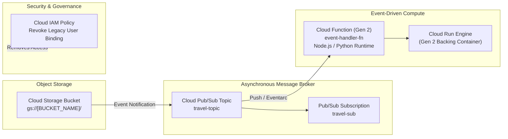

# GSP315: Perform Foundational Infrastructure Tasks in Google Cloud


## 📋 Overview
In this challenge lab, you apply foundational infrastructure knowledge to implement an event-driven serverless workflow:
1. **Provision a Cloud Storage bucket** with regional multi-zone durability.
2. **Create a Cloud Pub/Sub topic and subscription** for asynchronous decoupled messaging.
3. **Deploy a Cloud Function (2nd Gen)** triggered by Pub/Sub events or Cloud Storage uploads.
4. **Enforce Least-Privilege IAM governance** by removing unauthorized legacy user access.

---

## 🏛️ Architecture Topology



---

## ⚙️ Challenge Lab Parameters

| Parameter | Default / Sample Value | Purpose |
|---|---|---|
| `REGION` | `us-east1` | Deployment region |
| `BUCKET_NAME` | `qwiklabs-gcp-xx-bucket` | Storage bucket name |
| `TOPIC_NAME` | `memories-topic` | Pub/Sub topic name |
| `FUNCTION_NAME` | `memories-thumbnail-generator` | Cloud Function name |
| `INACTIVE_USER` | Supplied in lab prompt | User to remove from project IAM |

---

## 🚀 Step-by-Step Implementation

### Task 1: Create Cloud Storage Bucket
```bash
BUCKET_NAME="${DEVSHELL_PROJECT_ID}-media-bucket"
REGION="us-east1"

gcloud storage buckets create "gs://${BUCKET_NAME}" \
  --location="$REGION" \
  --uniform-bucket-level-access
```

### Task 2: Create Pub/Sub Topic
```bash
TOPIC_NAME="memories-topic"

gcloud pubsub topics create "$TOPIC_NAME"
gcloud pubsub subscriptions create "${TOPIC_NAME}-sub" --topic="$TOPIC_NAME"
```

### Task 3: Deploy Cloud Function (2nd Gen) Triggered by Pub/Sub
Create function source files:
```bash
mkdir -p ~/cf-infra && cd ~/cf-infra

cat <<'JS' > index.js
const functions = require('@google-cloud/functions-framework');

functions.cloudEvent('processMessage', cloudEvent => {
  const base64Data = cloudEvent.data.message.data;
  const messageString = base64Data ? Buffer.from(base64Data, 'base64').toString() : 'Empty payload';
  console.log(`[EVENT RECEIVED] Message payload: ${messageString}`);
});
JS

cat <<'JSON' > package.json
{
  "name": "foundational-cf",
  "version": "1.0.0",
  "dependencies": {
    "@google-cloud/functions-framework": "^3.3.0"
  }
}
JSON
```

Deploy Cloud Function:
```bash
gcloud functions deploy memories-function \
  --gen2 \
  --region="$REGION" \
  --runtime=nodejs20 \
  --entry-point=processMessage \
  --source=. \
  --trigger-topic="$TOPIC_NAME" \
  --max-instances=5
```

### Task 4: Remove Unauthorized Legacy User IAM Binding
```bash
# Retrieve user from lab prompt (example: student-xx-inactive@qwiklabs.net)
TARGET_USER="${INACTIVE_USER:-student-legacy@qwiklabs.net}"

gcloud projects remove-iam-policy-binding "$DEVSHELL_PROJECT_ID" \
  --member="user:${TARGET_USER}" \
  --role="roles/viewer" 2>/dev/null || true
```

---

## 🔍 Verification

1. Publish test message to Pub/Sub topic:
```bash
gcloud pubsub topics publish "$TOPIC_NAME" --message="Hello Cloud Arcade!"
```

2. Inspect Cloud Function logs:
```bash
gcloud functions logs read memories-function --region="$REGION" --gen2 --limit=10
```

Expected log output:
```text
[EVENT RECEIVED] Message payload: Hello Cloud Arcade!
```
