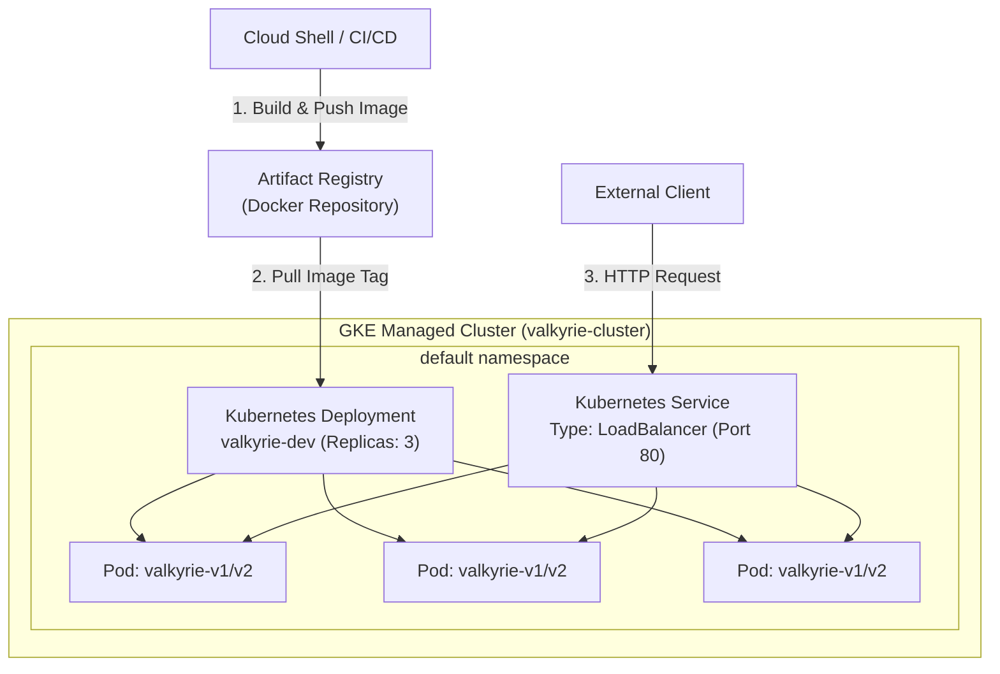

# GSP318: Deploy to Kubernetes in Google Cloud


## 📋 Overview
Google Kubernetes Engine (GKE) is an enterprise-grade managed Kubernetes service offering automated scaling, security hardening, and native Google Cloud integration.

In this challenge lab, you execute a containerized DevOps workflow:
1. **Provision a GKE Cluster** with optimized node pools and workload identity.
2. **Build and Push Docker Container Images** to Google Artifact Registry.
3. **Author Kubernetes Manifests** declaring Deployments, Services, and resource limits.
4. **Expose the Workload via Cloud Load Balancing** and execute a zero-downtime rolling update.

---

## 🏛️ Architecture Topology



---

## ⚙️ Challenge Lab Parameters

| Parameter | Recommended / Default Value | Purpose |
|---|---|---|
| `REGION` | `us-central1` | GKE Regional control plane |
| `ZONE` | `us-central1-a` | Zonal cluster location |
| `CLUSTER_NAME` | `valkyrie-cluster` | Target GKE cluster |
| `REPO_NAME` | `valkyrie-docker-repo` | Artifact Registry repo |
| `APP_NAME` | `valkyrie-dev` | Deployment & service name |

---

## 🚀 Step-by-Step Implementation

### Step 1: Create Google Kubernetes Engine Cluster
```bash
ZONE="us-central1-a"
CLUSTER_NAME="valkyrie-cluster"

gcloud services enable container.googleapis.com artifactregistry.googleapis.com

gcloud container clusters create "$CLUSTER_NAME" \
  --zone="$ZONE" \
  --num-nodes=2 \
  --machine-type=e2-medium \
  --release-channel=regular

gcloud container clusters get-credentials "$CLUSTER_NAME" --zone="$ZONE"
```

### Step 2: Create Artifact Registry Docker Repository
```bash
REPO="valkyrie-docker-repo"
REGION="us-central1"

gcloud artifacts repositories create "$REPO" \
  --repository-format=docker \
  --location="$REGION" \
  --description="Docker repository for GSP318" 2>/dev/null || true

gcloud auth configure-docker "${REGION}-docker.pkg.dev" --quiet
```

### Step 3: Scaffold Application & Build Image
```bash
mkdir -p ~/valkyrie-app && cd ~/valkyrie-app

cat <<'EOF' > server.js
const http = require('http');
const server = http.createServer((req, res) => {
  res.writeHead(200, { 'Content-Type': 'text/plain' });
  res.end('Valkyrie Application running on Google Kubernetes Engine! v1.0.0\n');
});
server.listen(8080, () => console.log('Server listening on port 8080'));
EOF

cat <<'EOF' > Dockerfile
FROM node:20-alpine
WORKDIR /app
COPY server.js .
EXPOSE 8080
CMD ["node", "server.js"]
EOF

IMAGE_TAG="${REGION}-docker.pkg.dev/${DEVSHELL_PROJECT_ID}/${REPO}/valkyrie-app:v1"
docker build -t "$IMAGE_TAG" .
docker push "$IMAGE_TAG"
```

### Step 4: Deploy Kubernetes Workload & Expose Service
```bash
cat <<EOF > deployment.yaml
apiVersion: apps/v1
kind: Deployment
metadata:
  name: valkyrie-dev
  labels:
    app: valkyrie
spec:
  replicas: 3
  selector:
    matchLabels:
      app: valkyrie
  template:
    metadata:
      labels:
        app: valkyrie
    spec:
      containers:
      - name: valkyrie-container
        image: ${IMAGE_TAG}
        ports:
        - containerPort: 8080
        resources:
          requests:
            cpu: 100m
            memory: 128Mi
---
apiVersion: v1
kind: Service
metadata:
  name: valkyrie-dev
spec:
  type: LoadBalancer
  selector:
    app: valkyrie
  ports:
  - protocol: TCP
    port: 80
    targetPort: 8080
EOF

kubectl apply -f deployment.yaml
```

### Step 5: Rolling Update (Version 2)
To satisfy challenge lab update checks:
```bash
sed -i 's/v1.0.0/v2.0.0/g' server.js
IMAGE_TAG_V2="${REGION}-docker.pkg.dev/${DEVSHELL_PROJECT_ID}/${REPO}/valkyrie-app:v2"
docker build -t "$IMAGE_TAG_V2" .
docker push "$IMAGE_TAG_V2"

# Execute rolling update
kubectl set image deployment/valkyrie-dev valkyrie-container="$IMAGE_TAG_V2"
kubectl rollout status deployment/valkyrie-dev
```

---

## 🔍 Verification & Testing

Inspect pods and retrieve external load balancer IP:
```bash
kubectl get pods -l app=valkyrie
kubectl get svc valkyrie-dev
```

Test application response:
```bash
SERVICE_IP="$(kubectl get svc valkyrie-dev -o jsonpath='{.status.loadBalancer.ingress[0].ip}')"
curl -s "http://${SERVICE_IP}"
```

Expected output:
```text
Valkyrie Application running on Google Kubernetes Engine! v2.0.0
```
