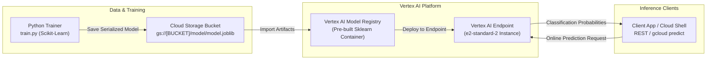

# GSP319: Build and Deploy Machine Learning Solutions on Vertex AI


## 📋 Overview
Vertex AI brings Google Cloud's machine learning tools together into a unified API, client library, and user interface.

In this challenge lab, you execute an end-to-end MLOps pipeline on Vertex AI:
1. **Enable Vertex AI APIs** and configure service account permissions.
2. **Train a Scikit-Learn Classification Model** and serialize model artifacts to Cloud Storage (`model.joblib`).
3. **Register the Model Artifacts in Vertex AI Model Registry** using Google pre-built prediction containers.
4. **Deploy the Model to a Dedicated Vertex AI Endpoint** with autoscaling compute resources.
5. **Send Online Inference Requests** and inspect real-time prediction probabilities.

---

## 🏛️ Architecture Topology



---

## ⚙️ Environment Variables

| Parameter | Recommended Value | Purpose |
|---|---|---|
| `REGION` | `us-central1` | Vertex AI regional service boundary |
| `MODEL_NAME` | `vertex-penguin-classifier` | Registered model display name |
| `ENDPOINT_NAME` | `penguin-prediction-endpoint` | Online inference endpoint |
| `SERVING_CONTAINER` | `us-docker.pkg.dev/vertex-ai/prediction/sklearn-cpu.1-3:latest` | Google-managed pre-built serving container |

---

## 🚀 Step-by-Step Implementation

### Step 1: Enable Required Google Cloud APIs
```bash
gcloud services enable \
  aiplatform.googleapis.com \
  storage.googleapis.com \
  compute.googleapis.com
```

### Step 2: Prepare Training Script & Train Scikit-Learn Model
Create a minimal training script that exports `model.joblib`:
```bash
mkdir -p ~/vertex-ml && cd ~/vertex-ml

cat <<'PY' > train.py
import joblib
from sklearn.datasets import load_iris
from sklearn.ensemble import RandomForestClassifier

# Load sample dataset
X, y = load_iris(return_X_y=True)

# Train model
clf = RandomForestClassifier(n_estimators=100, random_state=42)
clf.fit(X, y)

# Save artifact
joblib.dump(clf, "model.joblib")
print("Model trained and saved to model.joblib")
PY

python3 -m pip install -q scikit-learn joblib
python3 train.py
```

### Step 3: Upload Model Artifact to Cloud Storage
```bash
REGION="us-central1"
BUCKET_NAME="${DEVSHELL_PROJECT_ID}-vertex-artifacts"

gcloud storage buckets create "gs://${BUCKET_NAME}" --location="$REGION" 2>/dev/null || true
gcloud storage cp model.joblib "gs://${BUCKET_NAME}/model/model.joblib"
```

### Step 4: Register Model in Vertex AI Model Registry
```bash
gcloud ai models upload \
  --region="$REGION" \
  --display-name="penguin-classifier" \
  --container-image-uri="us-docker.pkg.dev/vertex-ai/prediction/sklearn-cpu.1-3:latest" \
  --artifact-uri="gs://${BUCKET_NAME}/model/"
```

### Step 5: Create Endpoint & Deploy Model
```bash
# Create Vertex AI Endpoint
gcloud ai endpoints create \
  --region="$REGION" \
  --display-name="penguin-endpoint"

# Retrieve generated IDs
MODEL_ID="$(gcloud ai models list --region="$REGION" --filter="displayName=penguin-classifier" --format="value(name)" | head -n1)"
ENDPOINT_ID="$(gcloud ai endpoints list --region="$REGION" --filter="displayName=penguin-endpoint" --format="value(name)" | head -n1)"

# Deploy Model to Endpoint
gcloud ai endpoints deploy-model "$ENDPOINT_ID" \
  --region="$REGION" \
  --model="$MODEL_ID" \
  --display-name="deployed-penguin-model" \
  --machine-type="n1-standard-2" \
  --min-replica-count=1 \
  --max-replica-count=1 \
  --traffic-split=0=100
```

---

## 🔍 Verification & Online Prediction

Prepare sample JSON instances input:
```bash
cat <<'JSON' > instances.json
{
  "instances": [
    [5.1, 3.5, 1.4, 0.2],
    [6.7, 3.0, 5.2, 2.3]
  ]
}
JSON
```

Submit online prediction to the endpoint:
```bash
gcloud ai endpoints predict "$ENDPOINT_ID" \
  --region="$REGION" \
  --json-request=instances.json
```

Expected output:
```json
[0, 2]
```
The endpoint returns class indices corresponding to input feature vectors!
