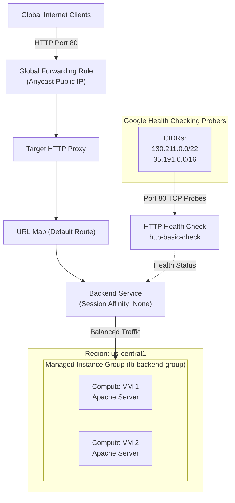

# GSP330: Implement Load Balancing on Compute Engine


## 📋 Overview
Google Cloud Global External Application Load Balancer distributes HTTP and HTTPS traffic across compute instances deployed in multiple regions worldwide.

In this challenge lab, you implement an autoscaling, highly available web tier:
1. **Create an Instance Template** configuring Apache web server via startup script.
2. **Deploy a Managed Instance Group (MIG)** with auto-healing and target capacity scaling.
3. **Configure Health Checks and Firewall Rules** allowing Google Cloud prober CIDR blocks.
4. **Provision a Global HTTP External Load Balancer** with backend service, URL map, target HTTP proxy, and global forwarding rule.

---

## 🏛️ Architecture Topology



---

## ⚙️ Environment Variables

| Variable | Value | Description |
|---|---|---|
| `REGION` | `us-central1` | Primary compute region |
| `ZONE` | `us-central1-a` | Compute zone |
| `TEMPLATE_NAME` | `lb-backend-template` | Compute instance template |
| `MIG_NAME` | `lb-backend-group` | Regional/zonal managed instance group |
| `LB_NAME` | `http-lb` | Global load balancer identifier |

---

## 🚀 Step-by-Step Implementation

### Step 1: Create Instance Template with Web Server
```bash
gcloud compute instance-templates create lb-backend-template \
  --region=us-central1 \
  --network=default \
  --subnet=default \
  --tags=allow-health-check \
  --machine-type=e2-micro \
  --metadata=startup-script='#! /bin/bash
apt-get update
apt-get install -y apache2
cat <<EOF > /var/www/html/index.html
<h1>GSP330 Web Server</h1>
<p>Served from instance: $(hostname)</p>
EOF
systemctl restart apache2
'
```

### Step 2: Create Managed Instance Group (MIG)
```bash
gcloud compute instance-groups managed create lb-backend-group \
  --template=lb-backend-template \
  --size=2 \
  --zone=us-central1-a

# Configure named port for HTTP traffic
gcloud compute instance-groups managed set-named-ports lb-backend-group \
  --named-ports=http:80 \
  --zone=us-central1-a
```

### Step 3: Configure Firewall Rule for Google Health Checks
Google Cloud probers connect from `130.211.0.0/22` and `35.191.0.0/16`:
```bash
gcloud compute firewall-rules create fw-allow-health-check \
  --network=default \
  --action=ALLOW \
  --direction=INGRESS \
  --source-ranges=130.211.0.0/22,35.191.0.0/16 \
  --target-tags=allow-health-check \
  --rules=tcp:80
```

### Step 4: Configure HTTP Health Check & Backend Service
```bash
# Create Health Check
gcloud compute health-checks create http http-basic-check \
  --port=80 \
  --check-interval=5s \
  --healthy-threshold=2 \
  --unhealthy-threshold=2

# Create Backend Service
gcloud compute backend-services create lb-backend-service \
  --protocol=HTTP \
  --port-name=http \
  --health-checks=http-basic-check \
  --global

# Attach MIG to Backend Service
gcloud compute backend-services add-backend lb-backend-service \
  --instance-group=lb-backend-group \
  --instance-group-zone=us-central1-a \
  --balancing-mode=UTILIZATION \
  --max-utilization=0.8 \
  --capacity-scaler=1 \
  --global
```

### Step 5: Configure URL Map, Target Proxy, and Forwarding Rule
```bash
# Create URL Map routing all requests to backend service
gcloud compute url-maps create http-lb-url-map \
  --default-service=lb-backend-service

# Create Target HTTP Proxy
gcloud compute target-http-proxies create http-lb-proxy \
  --url-map=http-lb-url-map

# Create Global Forwarding Rule
gcloud compute forwarding-rules create http-lb-forwarding-rule \
  --load-balancing-scheme=EXTERNAL_MANAGED \
  --network-tier=PREMIUM \
  --address-ip-version=IPV4 \
  --ports=80 \
  --target-http-proxy=http-lb-proxy \
  --global
```

---

## 🔍 Verification & Testing

Retrieve the allocated Anycast IP address:
```bash
LB_IP="$(gcloud compute forwarding-rules describe http-lb-forwarding-rule --global --format='value(IPAddress)')"
echo "Load Balancer Anycast IP: http://${LB_IP}"
```

Allow 2–3 minutes for proxy propagation and healthy instance registration, then test with curl:
```bash
while true; do
  curl -s -m 2 "http://${LB_IP}" | grep "Served from instance" && break
  echo "Waiting for load balancer backends to report healthy..."
  sleep 5
done
```

Expected output:
```text
<p>Served from instance: lb-backend-group-xxxx</p>
```
