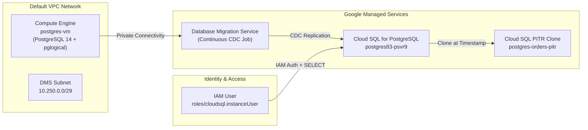

# GSP355: Cloud SQL PostgreSQL Challenge Lab


## 📋 Overview
In this challenge lab, you demonstrate your proficiency in managing, migrating, and securing relational databases on Google Cloud:
1. **Migrate an on-premises / standalone PostgreSQL instance** on Compute Engine to an existing Google Cloud SQL for PostgreSQL instance using Database Migration Service (DMS).
2. **Promote the Cloud SQL destination instance** once CDC synchronization is established.
3. **Configure IAM Database Authentication** for secure passwordless database access and grant least-privilege table permissions.
4. **Enable Point-in-Time Recovery (PITR)** and execute a point-in-time clone to revert accidental state modifications.

---

## 🏛️ Architecture Topology



---

## ⚙️ Lab Variables

| Parameter | Default / Lab Value | Description |
|---|---|---|
| `REGION` | `us-central1` | Primary deployment region |
| `INSTANCE` | `postgres83-psvr9` | Destination Cloud SQL instance ID |
| `DATABASE` | `orders` | Production application database |
| `SOURCE_VM` | `postgres-vm` | Source PostgreSQL Compute Engine VM |
| `MIGRATION_USER` | `import_admin` | Dedicated DMS replication user |
| `MIGRATION_JOB` | `gsp355-orders-migration` | DMS continuous replication job |
| `PITR_CLONE` | `postgres-orders-pitr` | Cloned target instance name |

---

## 🚀 Execution Steps

### Step 1: Clone Repository & Run Task 1 (Setup)
In Google Cloud Shell:
```bash
git clone https://github.com/harinish45/cloudarcadesolutions.git
cd cloudarcadesolutions/labs/gsp355-cloudsql-postgresql-challenge-lab
bash setup.sh
```

**What `setup.sh` automates:**
- Enables required Google Cloud APIs (`sqladmin`, `datamigration`, `servicenetworking`, `compute`).
- Discovers `postgres-vm` internal/external IPs and installs `postgresql-14-pglogical`.
- Configures `postgresql.conf` parameters: `wal_level=logical`, `max_replication_slots=10`.
- Adds primary keys to tables `distribution_centers`, `inventory_items`, `order_items`, `products`, `users`.
- Establishes DMS Private Connection profile (`10.250.0.0/29`) and firewall rule `allow-gsp355-dms-postgres`.
- Creates and initiates the continuous replication job `gsp355-orders-migration`.

### Step 2: Verify CDC State in Console
Monitor the DMS job until the phase displays **Continuous Replication in Progress / Ready for Promotion**:
```bash
gcloud database-migration migration-jobs describe gsp355-orders-migration --region=us-central1 --format="value(state,phase)"
```

### Step 3: Run Tasks 2 to 4 (Finish)
Once the job indicates CDC synchronization:
```bash
bash finish.sh
```

**What `finish.sh` automates:**
- Promotes the Cloud SQL instance to a primary standalone database.
- Patches the instance to enable `cloudsql.iam_authentication=on` and whitelists VM egress.
- Registers the lab user as `cloud_iam_user` with `roles/cloudsql.instanceUser`.
- Grants `SELECT` permission on `public.inventory_items` to the IAM user.
- Configures PITR with a 5-day transaction log retention window.
- Records current UTC timestamp, performs simulated update, and clones the instance to `postgres-orders-pitr`.

---

## 🔍 Verification & Testing

Verify IAM database authentication without passwords:
```bash
gcloud sql connect postgres83-psvr9 \
  --auto-iam-authn \
  --user="$(gcloud config get-value account)" \
  --database=orders \
  --quiet
```

Execute SQL test inside the session:
```sql
SELECT COUNT(*) FROM inventory_items;
```

Verify PITR cloned instance:
```bash
gcloud sql instances describe postgres-orders-pitr --format="table(name,state,databaseVersion)"
```

Expected output:
```text
NAME                  STATE     DATABASE_VERSION
postgres-orders-pitr  RUNNABLE  POSTGRES_14
```
